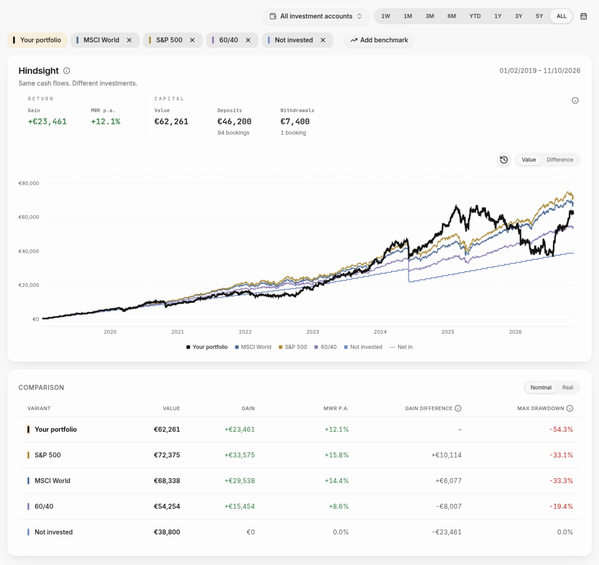

# Hindsight

**Would a simpler strategy have done better with your money?**

A [Wealthfolio](https://wealthfolio.app) addon that replays your actual deposits and withdrawals in an index
ETF, Bitcoin, any Yahoo Finance ticker or a fixed mix, and shows how much more or less you would have gained.



## Features

- **Gain difference:** the alternative's gain minus yours, with exactly your cash flows.
- **Money-weighted return** (XIRR) per line, nominal or inflation-adjusted.
- **Charts** of each line's value, or of its lead or gap over your portfolio.
- **Max drawdown** per line.
- **Mixes** of 2–5 assets, rebalanced monthly, quarterly, yearly or at a drift threshold.
- English and German, in Wealthfolio's number format.

## Install

Requires Wealthfolio 3.12 or later.

1. Download the ZIP from the [latest release](https://github.com/schabimperle/hindsight/releases/latest).
2. In Wealthfolio, open **Settings → Add-ons** and install the ZIP.
3. Approve the permissions and open **Hindsight** in the sidebar.

## Privacy

Hindsight reads accounts, activities and valuations through the Wealthfolio SDK and never changes them.
It fetches prices from Yahoo Finance and consumer price indices from the OECD; only tickers, dates,
currency pairs and a country code leave your device. No backend, no telemetry.

## How it works

Each deposit buys the alternative at that day's adjusted close, each withdrawal sells some of it: a Public
Market Equivalent (Long–Nickels). Results are before taxes and trading costs, and describe the past, not the
future. Details in [docs/MODEL.md](docs/MODEL.md).

## Development

```sh
npm ci --ignore-scripts
npm run check     # types, tests, reference model
npm run package   # build/hindsight.zip
```

See [CONTRIBUTING.md](CONTRIBUTING.md).

## License

MIT, except the vendored Wealthfolio chart marker (AGPL-3.0-only), which puts the distributed addon under
the AGPL as well. See [THIRD_PARTY_NOTICES.md](THIRD_PARTY_NOTICES.md).

Hindsight is not affiliated with Wealthfolio.
